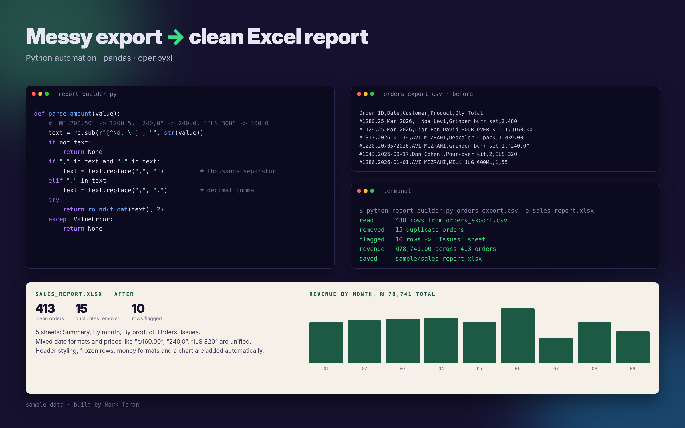

# Sales Report Builder

Turns a messy orders export (CSV) into a clean, formatted Excel report in one command.



## Why

Exports from shops, CRMs and payment systems are rarely clean: dates come in three formats, prices are written as `₪160.00`, `240,0` or `ILS 320`, names have extra spaces, and the same order shows up twice. Fixing that by hand every week takes hours. This script does it in seconds and never drops a row silently.

## What it does

| Problem in the export | What the script does |
|---|---|
| Mixed dates: `25 Mar 2026`, `2026-01-14`, `20/05/2026` | Parses all of them into real dates |
| Prices like `₪1,200.50`, `240,0`, `ILS 320` | Converts to numbers, handles thousands and decimal commas |
| `  Noa Levi`, `AVI MIZRAHI`, `POUR-OVER KIT` | Trims spaces and normalises capitalisation |
| Duplicate orders | Removes them by order ID |
| Impossible dates (`31/02/2026`), empty totals | Moves them to an **Issues** sheet for review |

The report has 5 sheets: **Summary**, **By month** (with a bar chart), **By product**, **Orders**, **Issues**. Headers are styled, the first row is frozen, money columns are formatted.

## Quick start

```bash
pip install -r requirements.txt
python report_builder.py orders_export.csv -o sales_report.xlsx
```

```
read      438 rows from orders_export.csv
removed   15 duplicate orders
flagged   10 rows -> 'Issues' sheet
revenue   ₪78,741.00 across 413 orders
saved     sales_report.xlsx
```

## Files

- `report_builder.py` — the tool
- `make_sample.py` — generates the fake messy export used in the demo
- `orders_export.csv` — sample input (fake data)
- `sales_report.xlsx` — sample output

## Adapting it

Date formats are listed at the top of `report_builder.py`, and the cleaning rules are small functions that are easy to adjust. The same approach works for Shopify, WooCommerce, Stripe or bank exports. If you need it for your data, [contact me on Upwork](https://www.upwork.com/freelancers/~01fdcade25dbc8df29).

Built with Python, pandas and openpyxl.
